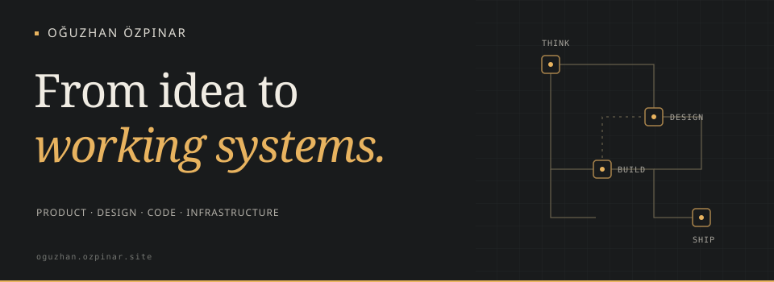
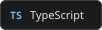
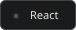
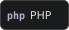
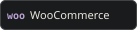
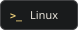
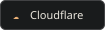
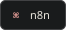

<picture>
  <source media="(max-width: 480px)" srcset="assets/cover-mobile.svg">
  
</picture>

## Hi, I'm Oğuzhan.

I turn ideas into **useful digital products** — from product thinking and interface design to development and deployment.

My work spans **nonprofit platforms, commerce, and automation.** 
Currently exploring AI agents, MCP, and self-hosted systems.

---

  
  
  
  
  
  

  
  
  
  

**Beyond code** · Cameras, homelabs, and connected notes.

  
  

